<h3><code>prithvikings@github ~ $ ./contributions.sh</code></h3>

  
<h3><code>prithvikings@github ~ $ whoami</code></h3>
<table><tr>
<td valign="top"></td>
<td valign="top"></td>
</tr></table>
  
<h3><code>prithvikings@github ~ $ ./stats.sh</code></h3>

  
<h3><code>prithvikings@github ~ $ ls ./projects</code></h3>
<table>
<tr><td valign="top" width="50%"><b><a href="https://github.com/prithvikings/BuddyBuild">BuddyBuild</a></b> AI-powered code review with persona-based analysis.</td><td valign="top" width="50%"><b><a href="https://github.com/prithvikings/greetCode">GreetCode</a></b> Coding-practice platform with an in-browser IDE and Judge0 execution.</td></tr>
<tr><td valign="top"><b><a href="https://github.com/prithvikings/simplay">Simplay</a></b> Video learning with transcript extraction and AI summarization.</td><td valign="top"><b><a href="https://github.com/prithvikings/DevPostGen">DevPostGen</a></b> Turn GitHub activity into shareable developer posts.</td></tr>
</table>
 
<h3><code>prithvikings@github ~ $ ./links.sh</code></h3>

<b>Full Stack Developer · AI Enthusiast · Builder</b>

  Built with Python, SVG, and GitHub Actions. Contribution art refreshes daily.

